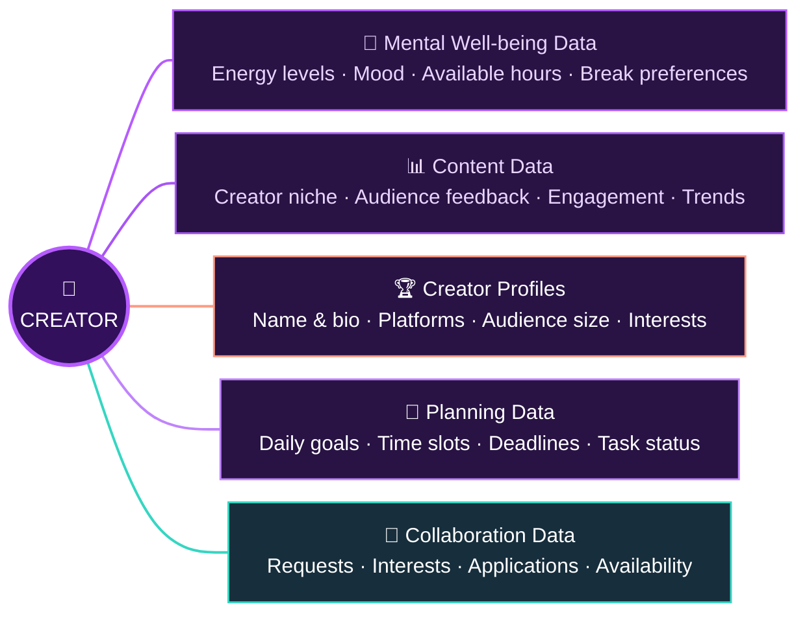

#  CreatorConnect

### Grow Together, Create Better.
## 📑 Table of Contents

1. [Brief One-Line Summary](#1-brief-one-line-summary)
2. [Problem Statement](#2-problem-statement)
3. [Dataset](#-3-dataset)
4. [Tools and Technologies](#4-tools-and-technologies)
5. [Method-Workflow](#5-method-workflow)
6. [Technical Architecture](#6-technical-architecture)
7. [Demo](#7-demo)
8. [Unique Selling Proposition](#8-unique-selling-proposition)
9. [Author & Contact](#9-author--contact)

## 1. Brief One-Line Summary

**CreatorConnect** is an AI-powered platform designed to help small and aspiring content creators understand their audience, make informed content decisions and improve their growth journey. It also features an **AI-powered Daily Planner** that helps creators organize their daily tasks, track their mental well-being, monitor their content growth and maintain a **healthy balance** between personal well-being and content creation.

## 2. Problem Statement

Small content creators often struggle with:

- Understanding audience feedback.
- Experiencing burnout, stress and loss of motivation.
- Maintaining consistency while balancing daily responsibilities.
- Switching between multiple platforms for ideas, insights and content planning.
'''

**Our Solution:**

CreatorConnect brings audience intelligence, AI-powered content planning and creator growth tracking into one platform.

## 📊 3. Dataset

**🤖 AI-Powered Data Processing:** Powered by **Google Gemini AI**, CreatorConnect analyses user inputs to generate intelligent market insights, creative content ideas and personalised weekly schedules, prioritising mental well-being and sustainable creator growth.

## 🛠️ 
## 4. Tools and Technologies

- **AI Integration:** Google Gemini AI (Gemini Flash models) – for market opportunity analysis, creative content suggestions and AI-powered weekly planning.
- **Database & Backend Services:** Supabase – for storing creator profiles, weekly plans, daily tasks and collaboration data.
- **API Development:** REST APIs – for creator discovery, collaboration requests, open listings and weekly plan management.
- **Frontend:** (Add your frontend framework and technologies here.)
- **Programming Languages:** (Add the languages used in your project.)
- **Development Tools:** Git, GitHub and Visual Studio Code.

## 5. Method-Workflow
       User Registration
               |
               v
        Creator Discovery
               |
               v
        AI Analysis (Gemini)
               |
               v
         Weekly Planning
               |
               v
      Daily Task Management
               |
               v
        Results & Insights
 Technology Integration:

Supabase  --->  Data Storage

Gemini AI  --->  AI-Powered Suggestions

REST APIs  --->  Backend Communication

## 6. Technical Architecture

(To include screenshots of the application, dashboard, AI-generated insights and working features.)

## 7. Demo

(To describe the implemented features, project outcomes and how CreatorConnect addresses the identified problem.)

## 8. Unique Selling Proposition

## 📊 Feature Comparison Matrix

CreatorConnect combines creator networking, collaboration, AI-powered content planning, progress tracking, and creator well-being into a single platform.

The following table compares CreatorConnect with existing platforms in the content creator market.

- ✅ Supported feature
- ❌ Not a core advertised feature

| Features | CreatorConnect | Instagram Creator Marketplace | TikTok One | Collabstr | Buffer | Later |
|---|:---:|:---:|:---:|:---:|:---:|:---:|
| Creator Discovery | ✅ | ✅ | ✅ | ✅ | ❌ | ❌ |
| Similar Niche Matching | ✅ | ✅ | ✅ | ✅ | ❌ | ❌ |
| Matching by Audience Size | ✅ | ✅ | ✅ | ✅ | ❌ | ❌ |
| Creator-to-Creator Networking | ✅ | ❌ | ❌ | ❌ | ❌ | ❌ |
| Community Discussions & Idea Sharing | ✅ | ❌ | ❌ | ❌ | ❌ | ❌ |
| Collaboration Opportunities | ✅ | ✅ | ✅ | ✅ | ❌ | ❌ |
| AI Weekly Content Planner | ✅ | ❌ | ❌ | ❌ | ❌ | ❌ |
| Energy-Based Content Scheduling | ✅ | ❌ | ❌ | ❌ | ❌ | ❌ |
| Burnout Prevention Support | ✅ | ❌ | ❌ | ❌ | ❌ | ❌ |
| Content Progress Timeline | ✅ | ❌ | ❌ | ❌ | ✅ | ✅ |
| Views & Follower Growth Tracking | ✅ | ✅ | ✅ | ✅ | ✅ | ✅ |
| Creator Growth Insights | ✅ | ✅ | ✅ | ✅ | ✅ | ✅ |

### 🌟 What Makes CreatorConnect Unique?

Unlike platforms that primarily focus on influencer marketing, brand partnerships, or social media management, CreatorConnect brings essential creator growth tools together in one place.

- 🤝 **Smart Networking:** Connect with creators who share similar interests, niches, and audience sizes.
- 🚀 **Collaboration Hub:** Find collaboration partners and grow through mutual support.
- 🤖 **AI Weekly Planner:** Generate personalized content plans based on available time and energy levels.
- ❤️ **Burnout Prevention:** Encourage realistic goals, breaks, and sustainable content creation.
- 📈 **Progress Timeline:** Track content creation efforts, views, and follower growth.

Our mission is not just to help creators gain followers, but to help them grow together without burning out.

## 9. Author & Contact

**Project:** CreatorConnect

**Team Members:** Kirti Sinha,Farina Ahamed,Dipanjan Maity,Sachi Kumari

**GitHub:** (Add repository links)

**Contact:** # creator-connect-
