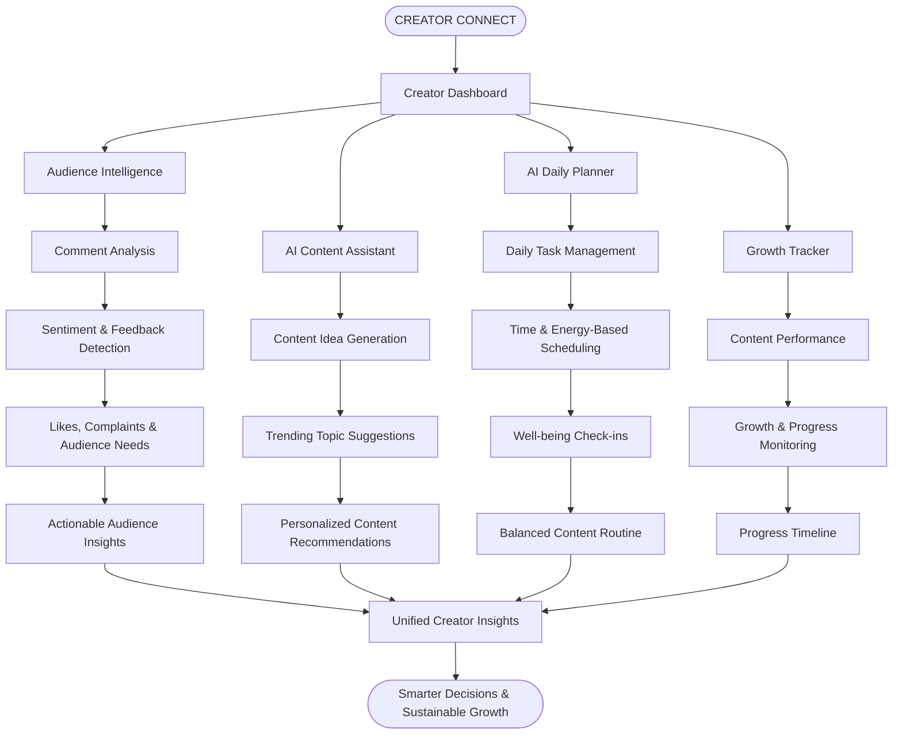
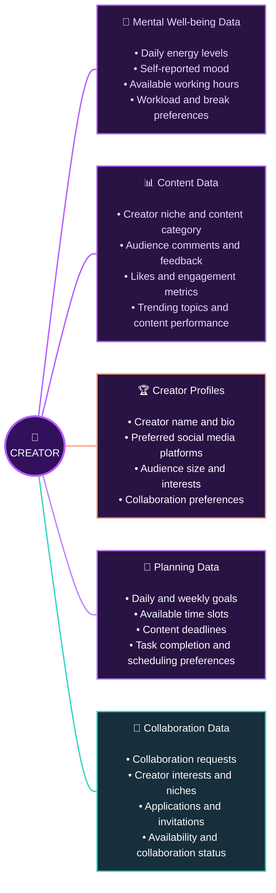

#  CreatorConnect

### Grow Together, Create Better.
## 📑 Table of Contents

1. [Brief One-Line Summary](#1-brief-one-line-summary)
2. [Problem Statement](#2-problem-statement)
3. [Dataset](#-3-dataset)
4. [Tools and Technologies](#4-tools-and-technologies)
5. [Method-Workflow](#5-method-workflow)
6. [Key features](#6-key-features)
7. [Technical Architecture](#7-technical-architecture)
8. [How to Run This Project](#8-how-to-run-this-project)
9. [Screenshots and Demo](#9-screenshots-and-demo)
10. [Innovation and Unique Selling Proposition](#10-innovation-and-unique-selling-proposition)
11. [Author & Contact](#11-author--contact)

## 1. Brief One-Line Summary

**CreatorConnect** is an AI-powered platform designed to help small and aspiring content creators understand their audience, make informed content decisions and improve their growth journey. It also features an **AI-powered Daily Planner** that helps creators organize their daily tasks, track their mental well-being, monitor their content growth and maintain a **healthy balance** between personal well-being and content creation.

## 2. Problem Statement

Small content creators often struggle with:

- Understanding audience feedback.
- Experiencing burnout, stress and loss of motivation.
- Maintaining consistency while balancing daily responsibilities.
- Switching between multiple platforms for ideas, insights and content planning.
'''

**Our Solution:**

### 3. Our Solution – CreatorConnect

CreatorConnect brings audience intelligence, AI-powered content planning and creator growth tracking into one platform.

## 📊 3. Dataset

**🤖 AI-Powered Data Processing:** Powered by **Google Gemini AI**, CreatorConnect analyses user inputs to generate intelligent market insights, creative content ideas and personalised weekly schedules, prioritising mental well-being and sustainable creator growth.

## 🛠️ 
## 4. Tools and Technologies

- **AI Integration:** Google Gemini AI (Gemini Flash models) – for market opportunity analysis, creative content suggestions and AI-powered weekly planning.
- **Database & Backend Services:** Supabase – for storing creator profiles, weekly plans, daily tasks and collaboration data.
- **API Development:** REST APIs – for creator discovery, collaboration requests, open listings and weekly plan management.
- **Frontend:** (Add your frontend framework and technologies here.)
- **Programming Languages:** (Add the languages used in your project.)
- **Development Tools:** Git, GitHub and Visual Studio Code.

## 5. Method-Workflow
       User Registration
               |
               v
        Creator Discovery
               |
               v
        AI Analysis (Gemini)
               |
               v
         Weekly Planning
               |
               v
      Daily Task Management
               |
               v
        Results & Insights
 Technology Integration:

Supabase  --->  Data Storage

Gemini AI  --->  AI-Powered Suggestions

REST APIs  --->  Backend Communication

    

## 6. Key features

  

## 7. Technical Architecture

(To include screenshots of the application, dashboard, AI-generated insights and working features.)

## 8. How to Run This Project?

(To include prerequisites, installation commands, environment configuration and instructions to run the application.)

## 9. Screenshots and Demo

(To describe the implemented features, project outcomes and how CreatorConnect addresses the identified problem.)

## 10. Innovation and Unique Selling Proposition

- More advanced audience sentiment analysis.
- Personalized content recommendations.
- Improved AI-powered content planning.
- Additional creator growth insights.

## 11. Author & Contact

**Project:** CreatorConnect

**Team Members:** (Add team members)

**GitHub:** (Add repository links)

**Contact:** (Add contact information)# creator-connect-
