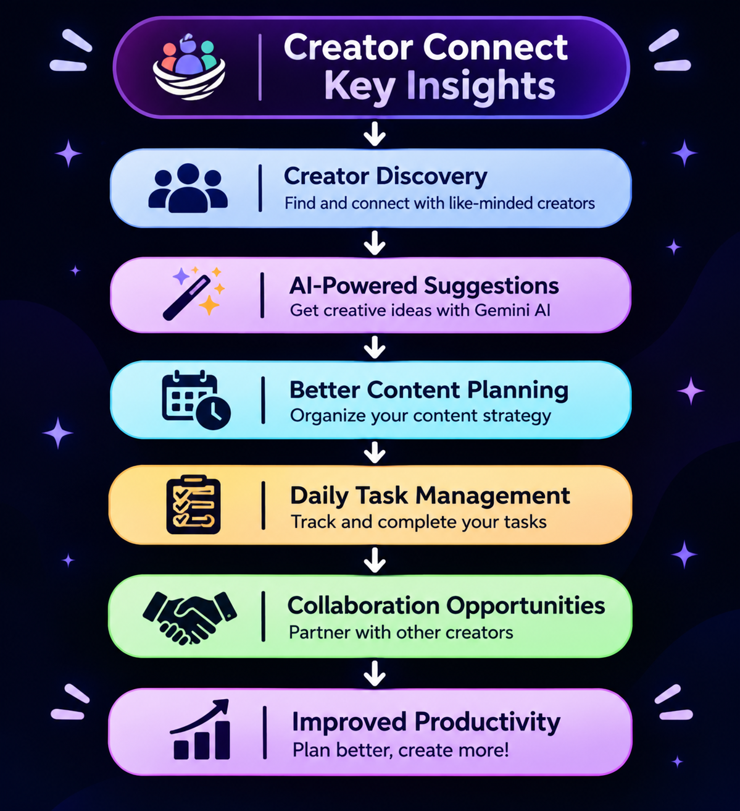

# 🚀 CreatorConnect

### Grow Together, Create Better.
## 📑 Table of Contents

1. [Brief One-Line Summary](#1-brief-one-line-summary)
2. [Overview](#2-overview)
3. [Problem Statement](#3-problem-statement)
4. [Dataset](#-4-dataset)
5. [Tools and Technologies](#-5-tools-and-technologies)
6. [Methods](#6-methods)
7. [Key Insights](#7-key-insights)
8. [Dashboard / Model / Output](#8-dashboard--model--output)
9. [How to Run This Project](#9-how-to-run-this-project)
10. [Results & Conclusion](#10-results--conclusion)
11. [Future Work](#11-future-work)
12. [Author & Contact](#12-author--contact)

## 1. Brief One-Line Summary

**CreatorConnect** is an AI-powered platform designed to help small and aspiring content creators understand their audience, make informed content decisions and improve their growth journey. It also features an **AI-powered Daily Planner** that helps creators organize their daily tasks, track their mental well-being, monitor their content growth and maintain a **healthy balance** between personal well-being and content creation.

## 2. Overview

CreatorConnect aims to simplify the content creation journey for beginner and small-scale creators.

The platform focuses on understanding audience feedback, generating useful content insights and helping creators make better decisions based on their audience's interests and preferences.

## 3. Problem Statement

Small content creators often struggle with:

- Understanding audience feedbacagement.
- Experiencing burnout, stress and loss of motivation.
- Maintaining consistency while balancing daily responsibilities.
- Switching between multiple platforms for ideas, insights and content planning.

**Our Solution:** CreatorConnect brings everything together in one AI-powered platform, offering audience insights, instant content ideas and a daily planner to track content growth and mental well-being.

## 📊 4. Dataset

CreatorConnect uses user-provided information and application data stored in Supabase to support creator well-being, content growth and collaboration.

- **Mental Well-being Data:** User-reported energy levels, daily availability and personal well-being inputs to help create balanced schedules and reduce creator burnout.
- **Content Data:** Topics, niches and platforms used for AI-powered market opportunity analysis and creative recommendations.
- **Creator Profiles:** Bios, niches, platforms, audience sizes and availability for discovering potential collaborators.
- **Planning Data:** Personal goals, available hours and energy levels used to generate personalised weekly plans with 1–2 complete rest days.
- **Collaboration Data:** Requests, applications and open listings stored in Supabase to support creator networking.

**🤖 AI-Powered Data Processing:** Powered by **Google Gemini AI**, CreatorConnect analyses user inputs to generate intelligent market insights, creative content ideas and personalised weekly schedules, prioritising mental well-being and sustainable creator growth.
## 🛠️ 5. Tools and Technologies

- **AI Integration:** Google Gemini AI (Gemini Flash models) – for market opportunity analysis, creative content suggestions and AI-powered weekly planning.
- **Database & Backend Services:** Supabase – for storing creator profiles, weekly plans, daily tasks and collaboration data.
- **API Development:** REST APIs – for creator discovery, collaboration requests, open listings and weekly plan management.
- **Frontend:** (Add your frontend framework and technologies here.)
- **Programming Languages:** (Add the languages used in your project.)
- **Development Tools:** Git, GitHub and Visual Studio Code.

## 6. Method-Workflow
       User Registration
               |
               v
        Creator Discovery
               |
               v
        AI Analysis (Gemini)
               |
               v
         Weekly Planning
               |
               v
      Daily Task Management
               |
               v
        Results & Insights
 Technology Integration:

Supabase  --->  Data Storage

Gemini AI  --->  AI-Powered Suggestions

REST APIs  --->  Backend Communication

    

## 7. Key Insights

  

## 8. Dashboard / Model / Output

(To include screenshots of the application, dashboard, AI-generated insights and working features.)

## 9. How to Run This Project?

(To include prerequisites, installation commands, environment configuration and instructions to run the application.)

## 10. Results & Conclusion

(To describe the implemented features, project outcomes and how CreatorConnect addresses the identified problem.)

## 11. Future Work

- More advanced audience sentiment analysis.
- Personalized content recommendations.
- Improved AI-powered content planning.
- Additional creator growth insights.

## 12. Author & Contact

**Project:** CreatorConnect

**Team Members:** (Add team members)

**GitHub:** (Add repository links)

**Contact:** (Add contact information)# creator-connect-
